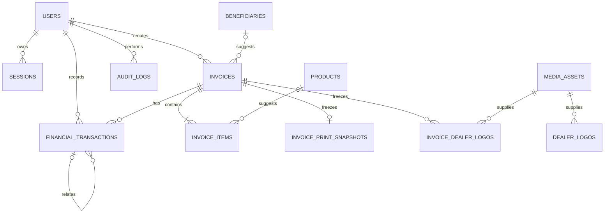

# تصميم قاعدة البيانات

## 1. الاختيار التقني

- قاعدة البيانات: SQLite.
- وضع التشغيل: WAL.
- تفعيل `PRAGMA foreign_keys = ON`.
- مهلة انتظار كتابة `busy_timeout`.
- المعرفات: UUIDv7 أو ULID نصية يولدها الخادم.
- أوقات النظام: ISO-8601 UTC.
- التواريخ التجارية: `YYYY-MM-DD`.
- المال النهائي: عدد صحيح بأصغر وحدة نقدية.
- الكميات والأسعار الوسيطة: نص Decimal قانوني، لا `REAL`.

## 2. مبادئ التصميم

1. الفاتورة تحفظ لقطتها التاريخية.
2. الاقتراحات ليست مصدرًا للفواتير السابقة.
3. الدفعات والاستردادات سجل موحد append-only مع الإبطال.
4. حالة الدفع مخزنة كقيمة مشتقة لتحسين البحث، وتحدث داخل transaction.
5. الوسائط ملفات غير قابلة للاستبدال في مكانها؛ التغيير ينشئ أصلًا جديدًا.
6. لا يوجد `ON DELETE CASCADE` من الاقتراحات أو المستخدمين إلى التاريخ التجاري.

## 3. مخطط العلاقات



## 4. الجداول

### 4.1 `users`

| العمود | النوع | القيود/المعنى |
|---|---|---|
| `id` | TEXT | PK |
| `username` | TEXT | NOT NULL, UNIQUE COLLATE NOCASE |
| `display_name` | TEXT | NOT NULL |
| `role` | TEXT | CHECK `ADMIN`,`EMPLOYEE` |
| `password_hash` | TEXT | NOT NULL |
| `is_active` | INTEGER | 0/1، الافتراضي 1 |
| `must_change_password` | INTEGER | 0/1 |
| `failed_login_count` | INTEGER | افتراضي 0 |
| `locked_until` | TEXT | nullable UTC |
| `last_login_at` | TEXT | nullable UTC |
| `created_at` | TEXT | NOT NULL |
| `created_by` | TEXT | FK users nullable لأول مدير |
| `updated_at` | TEXT | NOT NULL |
| `updated_by` | TEXT | FK users nullable |
| `row_version` | INTEGER | optimistic locking |

لا يوجد حذف. فهرس على `(is_active, role)`.

### 4.2 `sessions`

| العمود | النوع | القيود/المعنى |
|---|---|---|
| `id` | TEXT | PK |
| `user_id` | TEXT | FK users, NOT NULL |
| `token_hash` | TEXT | UNIQUE, NOT NULL |
| `created_at` | TEXT | NOT NULL |
| `last_seen_at` | TEXT | NOT NULL |
| `expires_at` | TEXT | NOT NULL |
| `absolute_expires_at` | TEXT | NOT NULL |
| `revoked_at` | TEXT | nullable |
| `client_label` | TEXT | وصف قصير اختياري |

فهرس على `(user_id, revoked_at)` و`expires_at`.

### 4.3 `app_settings`

صف singleton بمعرف `default`.

| العمود | النوع | المعنى |
|---|---|---|
| `id` | TEXT | PK = `default` |
| `company_name_ar` | TEXT | الاسم العربي |
| `company_name_en` | TEXT | الاسم الإنجليزي |
| `address` | TEXT | العنوان |
| `phones_json` | TEXT | مصفوفة هواتف |
| `email` | TEXT | اختياري |
| `registration_number` | TEXT | ضريبي/تسجيل |
| `currency_code` | TEXT | مثال SDG |
| `currency_symbol_ar` | TEXT | مثال ج.س |
| `currency_decimals` | INTEGER | 0–3 |
| `tax_enabled` | INTEGER | 0/1 |
| `default_tax_rate_bps` | INTEGER | 10000 = 100% |
| `invoice_number_pattern` | TEXT | تنسيق آمن |
| `sequence_reset_policy` | TEXT | `NEVER` أو `YEARLY` |
| `default_payment_terms` | TEXT | nullable |
| `footer_text` | TEXT | nullable |
| `date_display_format` | TEXT | من قائمة مقيدة |
| `paper_format` | TEXT | `A4`، لاحقًا `A5` |
| `timezone` | TEXT | IANA timezone |
| `lan_access_enabled` | INTEGER | معلومات/إعداد تشغيل |
| `session_idle_minutes` | INTEGER | إعداد الجلسة |
| `company_logo_asset_id` | TEXT | FK media_assets |
| `stamp_asset_id` | TEXT | FK media_assets |
| `signature_asset_id` | TEXT | FK media_assets |
| `updated_at` | TEXT | NOT NULL |
| `updated_by` | TEXT | FK users |
| `row_version` | INTEGER | optimistic locking |

### 4.4 `invoice_sequences`

| العمود | النوع | القيود |
|---|---|---|
| `sequence_key` | TEXT | PK، مثل `2026` أو `global` |
| `last_value` | INTEGER | NOT NULL |
| `updated_at` | TEXT | NOT NULL |

تخصيص الرقم والتحديث يتمان داخل نفس transaction.

### 4.5 `media_assets`

| العمود | النوع | المعنى |
|---|---|---|
| `id` | TEXT | PK |
| `kind` | TEXT | `COMPANY_LOGO`,`STAMP`,`SIGNATURE`,`DEALER_LOGO` |
| `original_name` | TEXT | اسم آمن للعرض |
| `mime_type` | TEXT | PNG/JPEG/WebP وفق السياسة |
| `relative_path` | TEXT | UNIQUE، لا مسار مطلق |
| `sha256` | TEXT | NOT NULL |
| `size_bytes` | INTEGER | NOT NULL |
| `width_px` | INTEGER | NOT NULL |
| `height_px` | INTEGER | NOT NULL |
| `is_active` | INTEGER | 0/1 |
| `created_at` | TEXT | NOT NULL |
| `created_by` | TEXT | FK users |

لا يحذف أصلًا مشارًا إليه من لقطة فاتورة. يمكن تنظيف غير المشار إليه بعد سياسة احتفاظ.

### 4.6 `dealer_logos`

يمثل القائمة الحالية في الإعدادات.

| العمود | النوع | القيود |
|---|---|---|
| `id` | TEXT | PK |
| `media_asset_id` | TEXT | FK media_assets, UNIQUE |
| `sort_order` | INTEGER | 0–4, UNIQUE |
| `label` | TEXT | اختياري |
| `created_at` | TEXT | NOT NULL |
| `updated_at` | TEXT | NOT NULL |

قيد خدمة: العدد الأقصى خمسة.

### 4.7 `beneficiaries`

| العمود | النوع | المعنى |
|---|---|---|
| `id` | TEXT | PK |
| `name` | TEXT | النص المعروض |
| `normalized_name` | TEXT | NOT NULL |
| `phone` | TEXT | nullable |
| `address` | TEXT | nullable |
| `registration_number` | TEXT | nullable |
| `is_active` | INTEGER | 0/1 |
| `use_count` | INTEGER | للترتيب |
| `last_used_at` | TEXT | nullable |
| `created_at` | TEXT | NOT NULL |
| `updated_at` | TEXT | NOT NULL |
| `updated_by` | TEXT | FK users |

فهرس على `normalized_name` و`(is_active,last_used_at)`. لا يفرض unique كاملًا لأن الأسماء قد تتكرر؛ يكتشف التطبيق المرشحين.

### 4.8 `products`

| العمود | النوع | المعنى |
|---|---|---|
| `id` | TEXT | PK |
| `name` | TEXT | NOT NULL |
| `normalized_name` | TEXT | NOT NULL |
| `description` | TEXT | nullable |
| `unit` | TEXT | nullable |
| `last_unit_price_decimal` | TEXT | Decimal canonical |
| `last_currency_code` | TEXT | nullable |
| `is_active` | INTEGER | 0/1 |
| `use_count` | INTEGER | للترتيب |
| `last_used_at` | TEXT | nullable |
| `created_at` | TEXT | NOT NULL |
| `updated_at` | TEXT | NOT NULL |
| `updated_by` | TEXT | FK users |

فهرس على `normalized_name` و`(is_active,last_used_at)`.

### 4.9 `invoices`

| العمود | النوع | المعنى |
|---|---|---|
| `id` | TEXT | PK |
| `invoice_number` | TEXT | NOT NULL UNIQUE |
| `invoice_status` | TEXT | `DRAFT`,`ISSUED`,`CANCELLED` |
| `payment_status` | TEXT | قيمة مشتقة |
| `is_archived` | INTEGER | 0/1 |
| `invoice_date` | TEXT | NOT NULL |
| `due_date` | TEXT | nullable |
| `beneficiary_id` | TEXT | FK beneficiaries nullable |
| `beneficiary_name` | TEXT | لقطة |
| `beneficiary_phone` | TEXT | لقطة |
| `beneficiary_address` | TEXT | لقطة |
| `beneficiary_registration_number` | TEXT | لقطة |
| `currency_code` | TEXT | لقطة |
| `currency_symbol` | TEXT | لقطة |
| `currency_decimals` | INTEGER | لقطة |
| `tax_enabled` | INTEGER | لقطة |
| `invoice_discount_kind` | TEXT | `NONE`,`PERCENT`,`FIXED` |
| `invoice_discount_rate_bps` | INTEGER | nullable |
| `invoice_discount_input_minor` | INTEGER | nullable |
| `subtotal_minor` | INTEGER | NOT NULL |
| `line_discounts_minor` | INTEGER | NOT NULL |
| `invoice_discount_minor` | INTEGER | NOT NULL |
| `discount_total_minor` | INTEGER | NOT NULL |
| `taxable_total_minor` | INTEGER | NOT NULL |
| `tax_total_minor` | INTEGER | NOT NULL |
| `grand_total_minor` | INTEGER | NOT NULL |
| `gross_paid_minor` | INTEGER | مشتق/مخزن |
| `refunded_total_minor` | INTEGER | مشتق/مخزن |
| `net_collected_minor` | INTEGER | مشتق/مخزن |
| `remaining_minor` | INTEGER | مشتق/مخزن |
| `notes` | TEXT | nullable |
| `payment_terms` | TEXT | nullable |
| `created_at` | TEXT | NOT NULL |
| `created_by` | TEXT | FK users |
| `updated_at` | TEXT | NOT NULL |
| `updated_by` | TEXT | FK users |
| `issued_at` | TEXT | nullable |
| `issued_by` | TEXT | FK users nullable |
| `cancelled_at` | TEXT | nullable |
| `cancelled_by` | TEXT | FK users nullable |
| `cancellation_reason` | TEXT | nullable |
| `archived_at` | TEXT | nullable |
| `archived_by` | TEXT | FK users nullable |
| `copied_from_invoice_id` | TEXT | self FK nullable |
| `row_version` | INTEGER | NOT NULL |

قيود `CHECK` للحالات وعدم سلبية المجاميع. فهارس:

- `(invoice_date DESC, invoice_number DESC)`
- `(invoice_status, payment_status, is_archived)`
- `beneficiary_name`
- `created_by`
- `due_date`
- `grand_total_minor`
- `updated_at`

### 4.10 `invoice_items`

| العمود | النوع | المعنى |
|---|---|---|
| `id` | TEXT | PK |
| `invoice_id` | TEXT | FK invoices ON DELETE RESTRICT |
| `product_id` | TEXT | FK products nullable |
| `sort_order` | INTEGER | NOT NULL |
| `product_name` | TEXT | لقطة |
| `description` | TEXT | لقطة |
| `unit` | TEXT | لقطة |
| `quantity_decimal` | TEXT | Decimal canonical |
| `unit_price_decimal` | TEXT | Decimal canonical |
| `base_minor` | INTEGER | محسوب |
| `discount_kind` | TEXT | NONE/PERCENT/FIXED |
| `discount_rate_bps` | INTEGER | nullable |
| `discount_input_minor` | INTEGER | nullable |
| `discount_minor` | INTEGER | محسوب |
| `allocated_invoice_discount_minor` | INTEGER | محسوب |
| `tax_rate_bps` | INTEGER | 10000 = 100% |
| `taxable_minor` | INTEGER | محسوب |
| `tax_minor` | INTEGER | محسوب |
| `line_total_minor` | INTEGER | محسوب |
| `created_at` | TEXT | NOT NULL |
| `updated_at` | TEXT | NOT NULL |

قيد فريد `(invoice_id, sort_order)`. فهرس على `product_name` و`product_id`.

### 4.11 `financial_transactions`

| العمود | النوع | المعنى |
|---|---|---|
| `id` | TEXT | PK |
| `invoice_id` | TEXT | FK invoices |
| `type` | TEXT | `PAYMENT`,`REFUND` |
| `status` | TEXT | `POSTED`,`VOIDED` |
| `amount_minor` | INTEGER | > 0 |
| `transaction_date` | TEXT | تاريخ تجاري |
| `payment_method` | TEXT | CASH/BANK_TRANSFER/CARD/CHEQUE/OTHER |
| `method_details` | TEXT | إلزامي عند OTHER |
| `reference_number` | TEXT | nullable |
| `reason` | TEXT | إلزامي للاسترداد |
| `notes` | TEXT | nullable |
| `related_transaction_id` | TEXT | self FK nullable |
| `created_at` | TEXT | NOT NULL |
| `created_by` | TEXT | FK users |
| `voided_at` | TEXT | nullable |
| `voided_by` | TEXT | FK users nullable |
| `void_reason` | TEXT | nullable |

فهارس على `(invoice_id,status,type)` و`transaction_date` و`created_by`.

### 4.12 `invoice_print_snapshots`

لقطة واحدة تُنشأ عند الإصدار.

| العمود | النوع | المعنى |
|---|---|---|
| `invoice_id` | TEXT | PK/FK invoices |
| `company_name_ar` | TEXT | لقطة |
| `company_name_en` | TEXT | لقطة |
| `address` | TEXT | لقطة |
| `phones_json` | TEXT | لقطة |
| `email` | TEXT | لقطة |
| `registration_number` | TEXT | لقطة |
| `footer_text` | TEXT | لقطة |
| `company_logo_asset_id` | TEXT | FK media_assets nullable |
| `stamp_asset_id` | TEXT | FK media_assets nullable |
| `signature_asset_id` | TEXT | FK media_assets nullable |
| `paper_format` | TEXT | لقطة |
| `captured_at` | TEXT | NOT NULL |

المسودة تستخدم الإعدادات الحالية في المعاينة. الصادرة تستخدم هذه اللقطة.

### 4.13 `invoice_dealer_logos`

| العمود | النوع | القيود |
|---|---|---|
| `invoice_id` | TEXT | FK invoices |
| `media_asset_id` | TEXT | FK media_assets |
| `sort_order` | INTEGER | 0–4 |

PK مركب `(invoice_id, sort_order)`.

### 4.14 `audit_logs`

| العمود | النوع | المعنى |
|---|---|---|
| `id` | TEXT | PK |
| `event_type` | TEXT | enum منطقي |
| `actor_user_id` | TEXT | FK users nullable للنظام |
| `actor_display_name` | TEXT | لقطة للاسم |
| `invoice_id` | TEXT | FK invoices nullable |
| `invoice_number` | TEXT | لقطة nullable |
| `entity_type` | TEXT | nullable |
| `entity_id` | TEXT | nullable |
| `summary` | TEXT | وصف عربي مختصر |
| `changes_json` | TEXT | JSON منظم ومحجوب |
| `created_at` | TEXT | NOT NULL |
| `request_id` | TEXT | لربط السجلات التقنية |

فهارس على `created_at`, `event_type`, `actor_user_id`, `invoice_id`.

## 5. البحث النصي

يُقترح جدول FTS5:

```sql
CREATE VIRTUAL TABLE invoice_search USING fts5(
  invoice_id UNINDEXED,
  invoice_number,
  beneficiary_name,
  product_names,
  tokenize = 'unicode61'
);
```

- يحدث داخل transaction بعد حفظ البنود.
- `product_names` دمج لأسماء البنود.
- البحث الدقيق بالرقم يستخدم فهرس `invoices.invoice_number`.
- عند غياب FTS5، يستخدم استعلام indexed prefix للرقم و`LIKE` محدود مع تحذير أداء.

## 6. المعاملات الذرية

### إنشاء/تعديل فاتورة

1. BEGIN IMMEDIATE.
2. تحقق `row_version`.
3. تخصيص الرقم عند الحاجة.
4. إعادة الحساب في الخادم.
5. upsert للاقتراحات.
6. حفظ الفاتورة والبنود.
7. تحديث FTS.
8. إضافة audit log.
9. COMMIT.

### حركة مالية

1. BEGIN IMMEDIATE.
2. قراءة الفاتورة والحركات النشطة.
3. التحقق من الحالة والحد.
4. إضافة الحركة.
5. إعادة حساب حقول الدفع والحالة.
6. إضافة audit log.
7. COMMIT.

## 7. النزاهة

- تشغيل `PRAGMA quick_check` دوريًا، و`integrity_check` قبل الاستعادة.
- قيود CHECK للمبالغ والحالات.
- foreign keys مفعلة في كل اتصال.
- لا يسمح بتعديل حقول المجاميع إلا من خدمة الحساب.
- اختبار reconciliation يعيد حساب كل فاتورة ويقارن القيم المخزنة.
- يوجد أمر صيانة إداري يولد تقرير اختلافات دون إصلاح تلقائي.

## 8. النسخ الاحتياطي

الحزمة:

```text
OIMS_backup_2026-07-29_183000.zip
├── manifest.json
├── database.sqlite
└── media/
    └── <content-addressed files>
```

`manifest.json`:

- `format_version`
- `schema_version`
- `app_version`
- `created_at`
- `created_by`
- `invoice_count`
- `media_count`
- SHA-256 لكل ملف

لا يُنسخ ملف SQLite الخام أثناء كتابة عادية؛ تستخدم SQLite backup API أو snapshot صحيحة.

## 9. الاستعادة

1. فك آمن يمنع path traversal وzip bombs.
2. التحقق من البيان والإصدار والأحجام والـ SHA-256.
3. فتح قاعدة مؤقتة وتشغيل `integrity_check`.
4. التحقق من migrations المدعومة.
5. التحقق من وجود كل أصل مذكور.
6. دخول وضع صيانة ومنع الكتابات.
7. إنشاء نسخة أمان للحالة الحالية.
8. atomic rename لمجلد البيانات.
9. فتح القاعدة وتشغيل smoke checks.
10. عند الفشل atomic rollback للحالة السابقة.
11. تسجيل حدث الاستعادة داخل القاعدة المستعادة.

## 10. سياسة الهجرة

- كل migration مرقمة ولا تعدل بعد إصدارها.
- التطبيق يرفض قاعدة أحدث من نسخته.
- النسخة الأقدم تُرقى على نسخة مؤقتة قبل الاستبدال.
- migration مالية تتضمن استعلام تحقق قبل وبعد.
- توجد اختبارات ترقية من كل إصدار مدعوم إلى الحالي.

