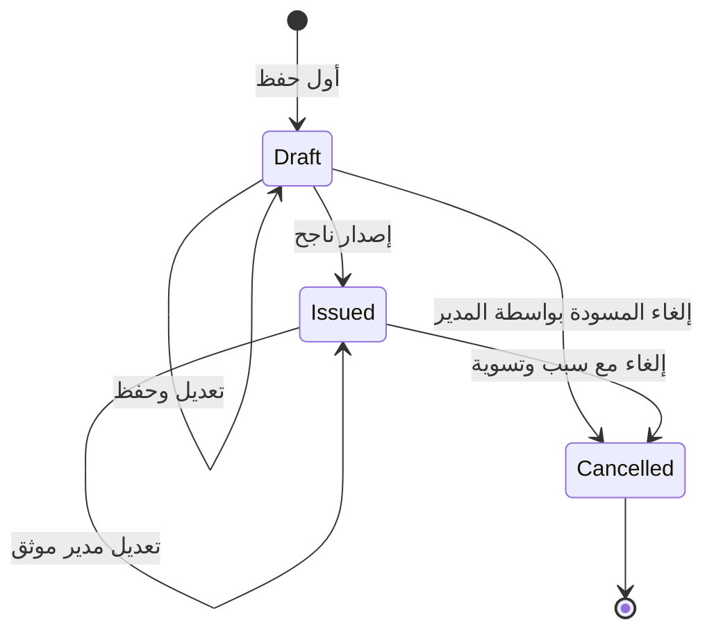
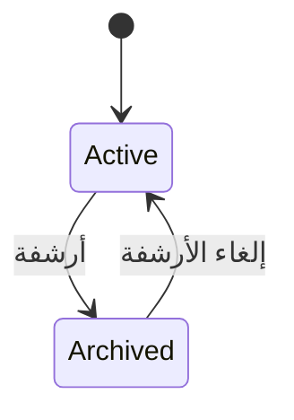
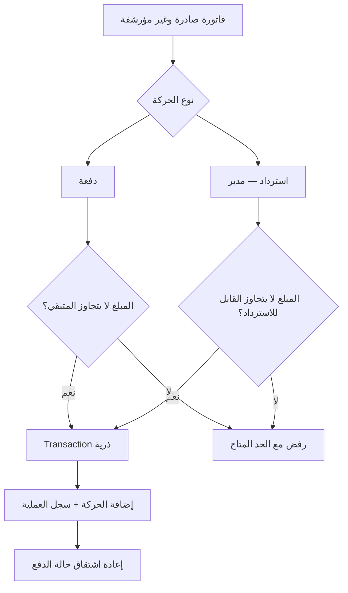
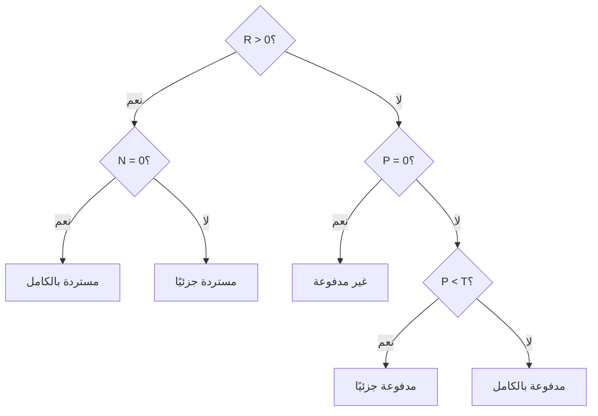
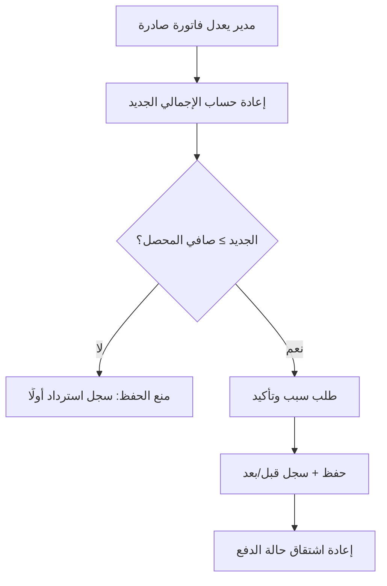

# تدفق حالة الفاتورة والدفع

## 1. المبدأ

توجد ثلاثة محاور مستقلة:

| المحور | القيم | من يغيره |
|---|---|---|
| حالة الفاتورة | مسودة، صادرة، ملغاة | إجراء مستخدم وفق الصلاحية |
| حالة الدفع | غير مدفوعة، جزئية، كاملة، مستردة جزئيًا، مستردة بالكامل | النظام آليًا |
| الأرشفة | نشطة، مؤرشفة | إجراء قابل للعكس |

لا يجوز دمج المحاور في حقل واحد أو استنتاج الأرشفة من حالة الفاتورة.

## 2. مخطط حالة الفاتورة



### 2.1 المسودة

- تقبل حقولًا ناقصة.
- لا تقبل دفعة أو استرداد.
- يمكن للموظف تعديلها.
- تظهر علامة «مسودة» في المعاينة والطباعة.
- يمكن إصدارها بعد اجتياز تحقق الإصدار.

### 2.2 الصادرة

- تمثل فاتورة رسمية.
- تقبل الدفعات.
- تقبل الاسترداد بصلاحية مدير.
- يقفل الموظف من تعديل المحتوى المالي.
- تعديل المدير يحتاج سببًا وسجل قبل/بعد.

### 2.3 الملغاة

- للقراءة فقط.
- لا تقبل دفعات جديدة.
- تقبل استرداد مبالغ سابقة حتى تصفير صافي المحصل.
- لا تعاد إلى صادرة؛ يتم النسخ إلى مسودة جديدة.
- لا تدخل في إجمالي المبيعات الافتراضي.

## 3. تحقق الإصدار

يُسمح بالانتقال من مسودة إلى صادرة فقط إذا:

1. يوجد اسم مستفيد.
2. يوجد بند واحد على الأقل.
3. كل بند له اسم وكمية أكبر من صفر وسعر غير سالب.
4. الخصومات والضرائب ضمن الحدود.
5. تاريخ الاستحقاق لا يسبق تاريخ الفاتورة.
6. الحساب النهائي أُعيد في الخادم.
7. رقم الفاتورة فريد ومحجوز.
8. لا يوجد تعارض `row_version`.

إذا فشل أكثر من شرط، تعرض جميع الأخطاء المرتبطة بالحقول دفعة واحدة.

## 4. تدفق الأرشفة



- يمكن أرشفة مسودة أو صادرة أو ملغاة.
- لا تغير الأرشفة أي حالة أو إجمالي.
- المؤرشفة للعرض والطباعة والنسخ فقط.
- يلزم إلغاء الأرشفة قبل التعديل أو تسجيل حركة مالية.

## 5. سجل الحركات المالية



## 6. اشتقاق حالة الدفع

### 6.1 المتغيرات

```text
T = إجمالي الفاتورة
P = مجموع الدفعات POSTED
R = مجموع الاستردادات POSTED
N = P - R
B = max(T - N, 0)
```

### 6.2 شجرة القرار



### 6.3 جدول أمثلة

على افتراض إجمالي فاتورة 1,000:

| الدفعات | المسترد | صافي المحصل | المتبقي | الحالة |
|---:|---:|---:|---:|---|
| 0 | 0 | 0 | 1,000 | غير مدفوعة |
| 400 | 0 | 400 | 600 | مدفوعة جزئيًا |
| 1,000 | 0 | 1,000 | 0 | مدفوعة بالكامل |
| 1,000 | 250 | 750 | 250 | مستردة جزئيًا |
| 1,000 | 1,000 | 0 | 1,000 | مستردة بالكامل |
| 400 | 400 | 0 | 1,000 | مستردة بالكامل |

في المثال الأخير، الحالة تعني أن كامل المبلغ الذي استُلم قد رُد، وليس أن كامل قيمة الفاتورة كانت قد حُصلت. لذلك تظهر الأرقام الخمسة معًا في شاشة التفاصيل.

## 7. حالات الدفع المسموح بها حسب حالة الفاتورة

| حالة الفاتورة | دفعة | استرداد | إبطال حركة | ملاحظة |
|---|---:|---:|---:|---|
| مسودة | لا | لا | لا | يجب الإصدار أولًا |
| صادرة نشطة | نعم | نعم للمدير | نعم للمدير | ضمن الحدود |
| صادرة مؤرشفة | لا | لا | لا | إلغاء الأرشفة أولًا |
| ملغاة | لا | نعم للمدير | نعم للمدير | لتسوية ما سبق فقط |
| ملغاة مؤرشفة | لا | لا | لا | إلغاء الأرشفة أولًا |

## 8. إبطال حركة خاطئة

لا تُحذف الحركة. يقوم المدير بما يلي:

1. يفتح الحركة.
2. يختار «إبطال الحركة».
3. يدخل سببًا إلزاميًا.
4. يؤكد الأثر على حالة الدفع.
5. يسجل النظام `voided_at`, `voided_by`, `void_reason`.
6. يعيد حساب المجاميع من الحركات `POSTED` فقط.
7. يسجل العملية في سجل العمليات.

إذا كان إبطال دفعة سيجعل مجموع الاستردادات أكبر من مجموع الدفعات النشطة، يمنع الإبطال حتى إبطال/تصحيح الاسترداد المرتبط.

## 9. تعديل فاتورة بها حركات



## 10. إلغاء فاتورة بها رصيد محصل

الوضع الافتراضي:

1. إذا كان `N = 0` يمكن الإلغاء بسبب إلزامي.
2. إذا كان `N > 0` يمنع الإلغاء ويعرض المبلغ المطلوب استرداده.
3. بعد تسجيل الاسترداد الكامل يمكن الإلغاء.
4. يوجد تجاوز إداري اختياري لا يُمنح إلا للمدير، بتأكيد ثانٍ ووصف واضح في السجل.

## 11. حالات الواجهة

| الحالة | اللون الدلالي | النص المختصر | الرمز المقترح |
|---|---|---|---|
| مسودة | رمادي | مسودة | ملف |
| صادرة | أزرق/فيروزي | صادرة | تحقق |
| ملغاة | أحمر | ملغاة | منع |
| غير مدفوعة | أحمر هادئ | غير مدفوعة | ساعة |
| مدفوعة جزئيًا | كهرماني | مدفوعة جزئيًا | دائرة نصفية |
| مدفوعة بالكامل | أخضر | مدفوعة بالكامل | تحقق |
| مستردة جزئيًا | بنفسجي | مستردة جزئيًا | سهم رجوع |
| مستردة بالكامل | بنفسجي داكن | مستردة بالكامل | سهمان |
| مؤرشفة | رمادي مزرق | مؤرشفة | صندوق |

النص والرمز إلزاميان؛ اللون وحده لا يكفي.

## 12. الأحداث المسجلة

- `INVOICE_CREATED`
- `INVOICE_UPDATED`
- `INVOICE_ISSUED`
- `INVOICE_CANCELLED`
- `INVOICE_ARCHIVED`
- `INVOICE_UNARCHIVED`
- `PAYMENT_ADDED`
- `REFUND_ADDED`
- `FINANCIAL_TRANSACTION_VOIDED`
- `INVOICE_COPIED`

كل حدث يحتوي المستخدم، الوقت، الفاتورة، وصفًا مختصرًا، وبيانات منظمة للتغيير عند الحاجة.

