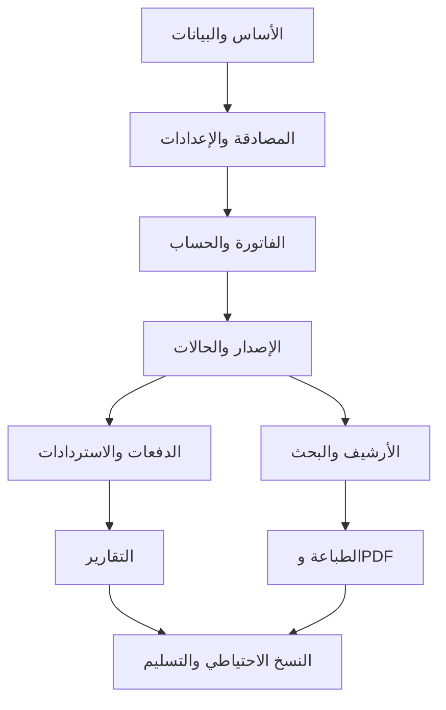

# قائمة أعمال MVP

## 1. طريقة القراءة

| الرمز | المعنى |
|---|---|
| P0 | ضروري للإطلاق |
| P1 | ضروري لإكمال تجربة الإصدار الأول، ويمكن إنجازه بعد النواة مباشرة |
| P2 | تحسين لاحق لا يمنع التشغيل الأساسي |
| S/M/L/XL | حجم نسبي، وليس تقدير أيام |

## 2. تعريف الإنجاز العام

لا تعد القصة مكتملة إلا إذا:

- طُبقت في الخادم والواجهة حسب الصلاحية.
- أضيفت migration عند الحاجة.
- أضيفت اختبارات وحدة وتكامل مناسبة.
- عولجت loading/empty/error/permission states.
- تعمل RTL ولوحة المفاتيح.
- لا تحتاج اتصالًا خارجيًا.
- سجلت العملية إن كانت ضمن سجل العمليات.
- اجتازت lint/typecheck/test/build.
- حدثت الوثائق عند تغير عقد متفق عليه.

## 3. ترتيب التنفيذ المقترح

## 4. EPIC-00 — تأسيس المشروع

| ID | الأولوية | القصة | الحجم | يعتمد على |
|---|---|---|---|---|
| FND-001 | P0 | تهيئة تطبيق TypeScript موحد للواجهة والخادم | M | — |
| FND-002 | P0 | تهيئة SQLite وWAL وforeign keys وmigrations | M | FND-001 |
| FND-003 | P0 | إعداد مجلد بيانات قابل للتهيئة خارج كود التطبيق | S | FND-001 |
| FND-004 | P0 | إضافة مكتبة Decimal ومنع الحساب بـNumber | M | FND-001 |
| FND-005 | P0 | إضافة validation مشترك وعقود أخطاء موحدة | M | FND-001 |
| FND-006 | P0 | إضافة logging تقني محلي مع حجب الأسرار | S | FND-001 |
| FND-007 | P0 | إضافة CI محلي: lint، typecheck، tests، build | M | FND-001 |
| FND-008 | P1 | health endpoint وحالة اتصال محلية | S | FND-001 |
| FND-009 | P1 | إعداد i18n بهيكل يدعم الإنجليزية لاحقًا | M | FND-001 |

### معايير Epic

- التطبيق يبدأ دون إنترنت.
- migration تنشئ قاعدة جديدة وتعيد التشغيل بلا تغيير.
- البيانات لا تكتب داخل مجلد source.

## 5. EPIC-01 — تسجيل الدخول والمستخدمون

| ID | الأولوية | القصة | الحجم | يعتمد على |
|---|---|---|---|---|
| AUTH-001 | P0 | إنشاء مدير أول عبر bootstrap آمن | M | FND-002 |
| AUTH-002 | P0 | تسجيل الدخول والجلسة والخروج | L | AUTH-001 |
| AUTH-003 | P0 | Argon2id وسياسة كلمة المرور | M | AUTH-001 |
| AUTH-004 | P0 | تعطيل الحساب وإلغاء جلساته | M | AUTH-002 |
| AUTH-005 | P0 | تغيير كلمة المرور الذاتية | M | AUTH-002 |
| AUTH-006 | P0 | middleware للصلاحيات والقدرات | L | AUTH-002 |
| AUTH-007 | P0 | إنشاء/تعديل/تعطيل مستخدم | L | AUTH-006 |
| AUTH-008 | P0 | منع تعطيل آخر مدير | S | AUTH-007 |
| AUTH-009 | P1 | rate limit ومحاولات الدخول | M | AUTH-002 |
| AUTH-010 | P1 | إجبار تغيير كلمة المرور المؤقتة | M | AUTH-005 |

## 6. EPIC-02 — إعدادات المنشأة والوسائط

| ID | الأولوية | القصة | الحجم | يعتمد على |
|---|---|---|---|---|
| SET-001 | P0 | نموذج بيانات المنشأة | M | AUTH-006 |
| SET-002 | P0 | إعداد العملة والمنازل العشرية | M | SET-001 |
| SET-003 | P0 | إعداد الضريبة الافتراضية | M | SET-001 |
| SET-004 | P0 | إعداد تنسيق الفاتورة والتسلسل | L | FND-002 |
| SET-005 | P0 | رفع شعار المنشأة بأمان | L | SET-001 |
| SET-006 | P0 | رفع الختم والتوقيع | M | SET-005 |
| SET-007 | P0 | إدارة خمسة شعارات وكلاء وترتيبها | L | SET-005 |
| SET-008 | P0 | نص التذييل وشروط الدفع | S | SET-001 |
| SET-009 | P1 | إعداد التاريخ والورق والجلسة | M | SET-001 |
| SET-010 | P1 | معاينة مصغرة للإعدادات | M | SET-005 |

## 7. EPIC-03 — اقتراحات المستفيدين والمنتجات

| ID | الأولوية | القصة | الحجم | يعتمد على |
|---|---|---|---|---|
| SUG-001 | P0 | schema وخدمة المستفيدين | M | FND-002 |
| SUG-002 | P0 | autocomplete المستفيد | M | SUG-001 |
| SUG-003 | P0 | حفظ/تحديث الاقتراح عند حفظ الفاتورة | M | INV-006 |
| SUG-004 | P0 | حذف منطقي وإعادة تنشيط مستفيد | M | SUG-001 |
| SUG-005 | P0 | schema وخدمة المنتجات | M | FND-002 |
| SUG-006 | P0 | autocomplete المنتج والسعر الأخير | M | SUG-005 |
| SUG-007 | P0 | تحديث آخر سعر بعد الحفظ | M | INV-006 |
| SUG-008 | P0 | حذف منطقي وإعادة تنشيط منتج | M | SUG-005 |
| SUG-009 | P1 | ترتيب الاقتراحات بالاستخدام والحداثة | S | SUG-002,SUG-006 |

## 8. EPIC-04 — محرك الفاتورة والحساب

| ID | الأولوية | القصة | الحجم | يعتمد على |
|---|---|---|---|---|
| INV-001 | P0 | schema الفاتورة والبنود واللقطات | XL | FND-002 |
| INV-002 | P0 | محرك حساب Decimal موحد | XL | FND-004 |
| INV-003 | P0 | خصم بند نسبة/ثابت | L | INV-002 |
| INV-004 | P0 | خصم فاتورة وتوزيعه largest remainder | XL | INV-003 |
| INV-005 | P0 | ضريبة بعد الخصم لكل بند | L | INV-004 |
| INV-006 | P0 | إنشاء وحفظ مسودة ذريًا | XL | INV-001,INV-002,SET-004 |
| INV-007 | P0 | محرر بنود وإعادة ترتيب | XL | INV-006 |
| INV-008 | P0 | optimistic locking | L | INV-006 |
| INV-009 | P0 | تحقق حدود الحقول والقيم | M | INV-006 |
| INV-010 | P1 | اختصارات لوحة المفاتيح وتحذير المغادرة | M | INV-007 |
| INV-011 | P1 | نسخ فاتورة لمسودة جديدة | L | INV-006 |

## 9. EPIC-05 — دورة حياة الفاتورة

| ID | الأولوية | القصة | الحجم | يعتمد على |
|---|---|---|---|---|
| LIFE-001 | P0 | إصدار مسودة والتحقق الكامل | L | INV-006 |
| LIFE-002 | P0 | لقطة طباعة وقت الإصدار | L | LIFE-001,SET-007 |
| LIFE-003 | P0 | قفل الموظف عن تعديل الصادرة | M | AUTH-006,LIFE-001 |
| LIFE-004 | P0 | تعديل المدير للصادرة بسبب وسجل | XL | LIFE-001,AUD-001 |
| LIFE-005 | P0 | إلغاء الفاتورة وتسوية الحركات | L | PAY-004 |
| LIFE-006 | P0 | علامات مائية للحالات | S | PRINT-001 |
| LIFE-007 | P1 | شريط تاريخ التعديل بعد الإصدار | S | LIFE-004 |

## 10. EPIC-06 — الدفعات والاستردادات

| ID | الأولوية | القصة | الحجم | يعتمد على |
|---|---|---|---|---|
| PAY-001 | P0 | schema سجل الحركات المالية | L | FND-002 |
| PAY-002 | P0 | إضافة دفعة مع حد المتبقي | XL | PAY-001,LIFE-001 |
| PAY-003 | P0 | عدة دفعات وطرق دفع | L | PAY-002 |
| PAY-004 | P0 | اشتقاق حالة الدفع والحقول المالية | XL | PAY-001 |
| PAY-005 | P0 | نافذة تسجيل دفعة | L | PAY-002 |
| REF-001 | P0 | تسجيل استرداد للمدير | XL | PAY-004,AUTH-006 |
| REF-002 | P0 | منع تجاوز القابل للاسترداد | M | REF-001 |
| REF-003 | P0 | نافذة الاسترداد ومعاينة الأثر | L | REF-001 |
| PAY-006 | P1 | إبطال حركة بدل حذفها | XL | PAY-004,AUD-001 |
| PAY-007 | P1 | ربط استرداد بدفعة | M | REF-001 |

## 11. EPIC-07 — الأرشيف والبحث

| ID | الأولوية | القصة | الحجم | يعتمد على |
|---|---|---|---|---|
| ARC-001 | P0 | قائمة فواتير paginated | L | INV-006 |
| ARC-002 | P0 | بحث رقم/مستفيد/منتج | XL | ARC-001 |
| ARC-003 | P0 | فلاتر الحالات والتاريخ والمبلغ والمنشئ | XL | ARC-001 |
| ARC-004 | P0 | الفرز وحفظ query في URL | M | ARC-001 |
| ARC-005 | P0 | أرشفة واستعادة مستقلة | L | ARC-001 |
| ARC-006 | P0 | شاشة تفاصيل الفاتورة | XL | PAY-004 |
| ARC-007 | P1 | اختيار متعدد وأرشفة جماعية | L | ARC-005 |
| ARC-008 | P1 | FTS5 وفحص إعادة بناء الفهرس | L | ARC-002 |

## 12. EPIC-08 — الطباعة وPDF

| ID | الأولوية | القصة | الحجم | يعتمد على |
|---|---|---|---|---|
| PRINT-001 | P0 | قالب فاتورة A4 RTL | XL | LIFE-002 |
| PRINT-002 | P0 | تكرار رأس الجدول ومنع تقسيم الصف | L | PRINT-001 |
| PRINT-003 | P0 | صفحة معاينة متعددة الصفحات | L | PRINT-001 |
| PRINT-004 | P0 | نافذة ختم/توقيع ولون/mono | M | PRINT-001 |
| PRINT-005 | P0 | طباعة المتصفح | M | PRINT-003 |
| PDF-001 | P0 | محرك PDF محلي من نفس القالب | XL | PRINT-001 |
| PDF-002 | P0 | اسم ملف عربي آمن | M | PDF-001 |
| PDF-003 | P0 | أرقام صفحات وخطوط مضمنة | L | PDF-001 |
| PDF-004 | P1 | طابور وحدود وقت وذاكرة | L | PDF-001 |
| PRINT-006 | P2 | دعم A5 | L | نجاح A4 |

## 13. EPIC-09 — التقارير

| ID | الأولوية | القصة | الحجم | يعتمد على |
|---|---|---|---|---|
| RPT-001 | P0 | بطاقات الملخص وفترة التقرير | XL | PAY-004 |
| RPT-002 | P0 | المبيعات اليومية/الشهرية | L | RPT-001 |
| RPT-003 | P0 | توزيع حالات الدفع | M | RPT-001 |
| RPT-004 | P0 | أعلى المستفيدين | L | RPT-001 |
| RPT-005 | P0 | أكثر المنتجات ظهورًا | L | RPT-001 |
| RPT-006 | P0 | الفواتير المتأخرة | L | RPT-001 |
| RPT-007 | P1 | drill-down إلى الأرشيف | M | ARC-003 |
| RPT-008 | P1 | طباعة وPDF للتقرير | L | PDF-001 |
| RPT-009 | P2 | تصدير CSV | M | RPT-001 |

## 14. EPIC-10 — سجل العمليات

| ID | الأولوية | القصة | الحجم | يعتمد على |
|---|---|---|---|---|
| AUD-001 | P0 | schema وخدمة append-only | L | FND-002 |
| AUD-002 | P0 | ربط أحداث الفواتير والحركات | L | AUD-001 |
| AUD-003 | P0 | ربط الإعدادات والمستخدمين | M | AUD-001 |
| AUD-004 | P0 | شاشة بحث وفلترة للمدير | L | AUD-001 |
| AUD-005 | P0 | حجب الأسرار من changes_json | M | AUD-001 |
| AUD-006 | P1 | تبويب سجل الفاتورة | M | ARC-006 |

## 15. EPIC-11 — النسخ الاحتياطي والاستعادة

| ID | الأولوية | القصة | الحجم | يعتمد على |
|---|---|---|---|---|
| BKP-001 | P0 | snapshot SQLite سليمة | L | FND-002 |
| BKP-002 | P0 | حزمة قاعدة+وسائط+manifest+checksums | XL | BKP-001,SET-005 |
| BKP-003 | P0 | تنزيل باسم مؤرخ | S | BKP-002 |
| BKP-004 | P0 | تحقق آمن في مساحة مؤقتة | XL | BKP-002 |
| BKP-005 | P0 | نسخة أمان وتبديل ذري وrollback | XL | BKP-004 |
| BKP-006 | P0 | واجهة تحذير وإعادة تحقق مدير | L | BKP-005,AUTH-006 |
| BKP-007 | P0 | إنهاء الجلسات وتسجيل الاستعادة | M | BKP-005,AUD-001 |
| BKP-008 | P1 | أمر CLI لاختبار نسخة دون استعادتها | M | BKP-004 |

## 16. EPIC-12 — الجودة والتسليم المحلي

| ID | الأولوية | القصة | الحجم | يعتمد على |
|---|---|---|---|---|
| QA-001 | P0 | اختبارات قبول آلية للقواعد المالية | XL | INV-002,PAY-004 |
| QA-002 | P0 | اختبارات صلاحيات لكل endpoint | L | AUTH-006 |
| QA-003 | P0 | visual regression للطباعة المرجعية | L | PRINT-001 |
| QA-004 | P0 | اختبار 100 ألف فاتورة مولدة | L | ARC-002,RPT-001 |
| QA-005 | P0 | اختبار انقطاع/إغلاق أثناء الكتابة | M | INV-006 |
| QA-006 | P0 | حزمة تشغيل محلية موثقة | XL | كل P0 |
| QA-007 | P0 | إعداد وصول LAN وجدار حماية موثق | M | QA-006 |
| QA-008 | P0 | دليل نسخ احتياطي واستعادة للمستخدم | M | BKP-006 |
| QA-009 | P1 | اختبار قارئ شاشة ولوحة مفاتيح | M | الواجهات |
| QA-010 | P1 | فحص أمني للرفع والجلسات وCSRF | L | AUTH,SET |

## 17. بوابات الإصدار

### Gate A — نواة الفاتورة

- إنشاء/حفظ/إصدار فاتورة.
- الحسابات المرجعية ناجحة.
- لا تكرار أرقام تحت التزامن.
- اقتراحات لا تغير التاريخ.

### Gate B — التحصيل

- عدة دفعات.
- استرداد وإبطال.
- حالات مشتقة صحيحة.
- منع التجاوز والتعديل غير الآمن.

### Gate C — الاستخراج

- بحث وفلاتر.
- طباعة A4 وPDF.
- تقارير متصالحة.

### Gate D — التشغيل

- مستخدمون وصلاحيات.
- سجل عمليات.
- نسخة احتياطية واستعادة مجربتان.
- تشغيل بلا إنترنت وعلى LAN خاص.

## 18. قصص لا تُسحب إلى MVP

- أي مخزون أو كمية متاحة.
- مشتريات أو موردون.
- ربح أو سعر تكلفة.
- تطبيق هاتف.
- مزامنة سحابية أو فروع.
- بريد/واتساب.
- قوالب فواتير متعددة قابلة للبرمجة.
- صلاحيات مخصصة per-user.

