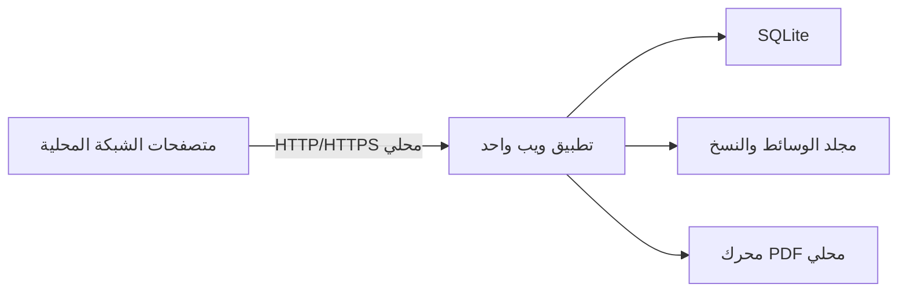

# متطلبات المنتج — نظام إدارة فواتير أعمال عمر إبراهيم

## 1. معلومات الوثيقة

| الحقل | القيمة |
|---|---|
| اسم المنتج المؤقت | Omer Ibrahim Invoice Management System |
| اسم المنشأة | أعمال عمر إبراهيم أحمد سليمان للاستيراد وتوزيع المستلزمات الطبية |
| الاسم الإنجليزي | OMER IBRAHIM MEDICAL SUPPLIES |
| نوع الوثيقة | Product Requirements Document (PRD) |
| الإصدار | 1.0 — مرحلة التحليل والتصميم |
| التاريخ | 29 يوليو 2026 |
| اللغة الأساسية | العربية RTL |
| حالة المنتج | تصميم قبل التنفيذ |

## 2. الملخص التنفيذي

النظام تطبيق ويب محلي خفيف لإنشاء فواتير مبيعات المستلزمات والمعدات الطبية، متابعة تحصيلها، أرشفتها، طباعتها، واستخراج تقارير منها. يعمل على جهاز أساسي داخل المحل، ويمكن فتحه من أجهزة أخرى ضمن الشبكة المحلية بعد تفعيل الوصول الشبكي.

ليس النظام مخزونًا، أو نقاط بيع، أو برنامج محاسبة. تُحفظ أسماء المستفيدين والمنتجات فقط لتسريع الاقتراحات داخل الفاتورة، بينما تظل بيانات كل فاتورة محفوظة كلقطة مستقلة لا تتغير عند تعديل الاقتراحات لاحقًا.

## 3. المشكلة

الاعتماد على ملفات متفرقة أو فواتير يدوية يؤدي إلى:

- بطء إنشاء الفاتورة وتكرار إدخال بيانات المستفيد والمنتج.
- احتمالية تكرار رقم الفاتورة أو الخطأ في الإجماليات.
- صعوبة معرفة غير المدفوع والمدفوع جزئيًا والمسترد.
- اختلاط حالة الفاتورة بحالة الدفع أو بالأرشفة.
- صعوبة البحث في الفواتير القديمة حسب المنتج أو المستفيد.
- اختلاف شكل الطباعة وملفات PDF.
- فقدان أثر من أنشأ أو عدّل أو سجّل دفعة.
- صعوبة النسخ الاحتياطي والاستعادة بصورة آمنة.

## 4. الرؤية

إنشاء أسرع وأوضح نظام محلي لإدارة فواتير المنشأة، يتيح للموظف إصدار فاتورة صحيحة في دقائق، ويتيح للمدير معرفة وضع التحصيل والوصول إلى أي فاتورة فورًا.

## 5. أهداف المنتج

1. تقليل زمن إنشاء فاتورة معتادة إلى أقل من ثلاث دقائق بعد توفر الاقتراحات.
2. منع تكرار أرقام الفواتير والحسابات غير الدقيقة.
3. إبقاء حالة الفاتورة والدفع والأرشفة مستقلة وواضحة.
4. إتاحة البحث عن فاتورة خلال ثوانٍ برقمها أو مستفيدها أو أحد منتجاتها.
5. إنتاج طباعة وPDF احترافيين ومتطابقين قدر الإمكان.
6. العمل دون اتصال دائم بالإنترنت ودون اعتماد سحابي إلزامي.
7. توفير نسخة احتياطية كاملة قابلة للتحقق والاستعادة الآمنة.
8. تسليم مواصفات دقيقة تسمح لـ Codex ببناء النظام دون تخمينات جوهرية.

## 6. مؤشرات النجاح

| المؤشر | الهدف بعد الاستقرار |
|---|---|
| متوسط زمن إنشاء فاتورة من 3 بنود | ≤ 3 دقائق |
| أخطاء الجمع اليدوي | صفر؛ الحساب يتم برمجيًا فقط |
| أرقام فواتير مكررة | صفر |
| زمن البحث المعتاد | ≤ ثانيتين عند 100 ألف فاتورة على الجهاز الموصى به |
| نجاح توليد PDF | ≥ 99% للفواتير الصحيحة |
| نجاح الاستعادة في اختبار دوري | 100% للنسخ السليمة |
| عمليات مالية بلا سجل مستخدم | صفر |

## 7. المستخدمون

### 7.1 المدير

- يدير المستخدمين والإعدادات والنسخ الاحتياطية.
- يراجع جميع الفواتير والتقارير والسجل.
- يملك صلاحيات الإلغاء والاسترداد وتعديل الفاتورة الصادرة ضمن القواعد.

### 7.2 الموظف

- ينشئ المسودات ويعدلها ويصدرها.
- يعرض الفواتير ويطبعها ويؤرشفها.
- يسجل الدفعات.
- لا يدير المستخدمين أو الإعدادات الحساسة أو الاستعادة أو الاسترداد.

تفاصيل الصلاحيات في `USER_ROLES_AND_PERMISSIONS.md`.

## 8. نطاق الإصدار الأول

### 8.1 داخل النطاق

- تسجيل الدخول وإدارة مستخدمين محليين.
- إنشاء وتعديل وإصدار وإلغاء الفواتير.
- اقتراح المستفيدين والمنتجات وحذف الاقتراحات سريعًا.
- خصومات على مستوى البند والفاتورة.
- ضريبة اختيارية وحساب دقيق.
- سجل دفعات واستردادات غير قابل للحذف المباشر.
- حالات فاتورة ودفع مستقلة.
- أرشفة واستعادة الفاتورة.
- بحث وفلاتر وفرز ونسخ فاتورة.
- طباعة A4 وتوليد PDF.
- شعار المنشأة والختم والتوقيع وحتى خمسة شعارات وكلاء.
- تقارير مبنية على الفواتير.
- نسخ احتياطي كامل واستعادة آمنة.
- سجل عمليات.
- واجهة عربية RTL متجاوبة مع سطح المكتب والأجهزة اللوحية.

### 8.2 خارج النطاق

- المخزون والمستودعات والكميات المتاحة.
- المشتريات والموردون.
- سعر التكلفة والربح المحاسبي.
- دفتر الأستاذ والقيود المحاسبية.
- نقاط البيع والباركود.
- الشحن والتوصيل.
- الرواتب والموارد البشرية.
- تطبيق هاتف أصلي.
- بوابة المستفيد.
- إرسال بريد أو واتساب تلقائي.
- استضافة سحابية إلزامية.
- مزامنة فروع متعددة.
- العملات المتعددة داخل الفاتورة الواحدة.
- إشعارات خارج النظام.

## 9. افتراضات وقرارات معتمدة

1. الجهاز الأساسي هو مصدر الحقيقة الوحيد في الإصدار الأول.
2. قاعدة البيانات محلية من نوع SQLite، مع ملفات الوسائط في مجلد بيانات التطبيق.
3. الاتصال من أجهزة الشبكة يتم بالخادم المحلي نفسه، وليس بمزامنة قواعد متعددة.
4. كل فاتورة تحفظ العملة ومنازلها العشرية ونسبة الضريبة وبيانات المنشأة والمستفيد والبنود كلقطات تاريخية.
5. تغيير الإعدادات لا يغيّر الفواتير السابقة.
6. لا يوجد حذف نهائي للفواتير أو الحركات المالية؛ الإلغاء والأرشفة والإبطال الموثق هي البدائل.
7. رقم الفاتورة يُحجز عند أول حفظ ناجح للمسودة، ولا يعاد استخدامه.
8. الضريبة في الإصدار الأول تضاف بعد الخصم وليست شاملة للسعر.
9. إجماليات المال تُحسب بمكتبة أعداد عشرية، ولا تستخدم JavaScript floating point للحساب المالي.
10. الاسترداد يعكس مبلغًا سبق تحصيله ولا يجوز أن يتجاوز صافي المبلغ القابل للاسترداد.
11. التقارير الافتراضية تستبعد المسودات والملغاة، وتضم المؤرشفة لأنها ما زالت فواتير تاريخية.
12. يظل النموذج البصري المرفق مرجعًا للواجهة فقط، وليس كود إنتاج.

## 10. المتطلبات الوظيفية

### 10.1 المصادقة والمستخدمون

- **FR-AUTH-001:** يعرض النظام صفحة تسجيل دخول باسم مستخدم وكلمة مرور.
- **FR-AUTH-002:** يرفض المستخدم المعطل حتى مع صحة كلمة المرور.
- **FR-AUTH-003:** يطلب من المستخدم الأول تغيير كلمة المرور المؤقتة.
- **FR-AUTH-004:** يسمح لكل مستخدم بتغيير كلمة مروره بعد إدخال الحالية.
- **FR-AUTH-005:** يسمح للمدير بإنشاء موظف أو مدير وتعطيله وإعادة تفعيله وإعادة تعيين كلمة مروره.
- **FR-AUTH-006:** يمنع تعطيل آخر مدير نشط.
- **FR-AUTH-007:** تنتهي الجلسة بعد مدة خمول قابلة للإعداد، افتراضيًا 30 دقيقة.
- **FR-AUTH-008:** يسجل المستخدم المرتبط بكل إنشاء أو تعديل أو حركة مالية.

### 10.2 الفواتير

- **FR-INV-001:** ينشئ النظام رقم فاتورة فريدًا ذريًا وفق التنسيق والإعدادات.
- **FR-INV-002:** يمكن حفظ الفاتورة كمسودة أو إصدارها.
- **FR-INV-003:** يدعم تاريخ الفاتورة وتاريخ استحقاق اختياريًا.
- **FR-INV-004:** يدعم مستفيدًا وبندًا واحدًا على الأقل عند الإصدار.
- **FR-INV-005:** يحسب المجاميع والخصم والضريبة آليًا.
- **FR-INV-006:** يمنع إدخال قيم سالبة أو صفرية حيث لا تكون منطقية.
- **FR-INV-007:** يسمح بإعادة ترتيب البنود.
- **FR-INV-008:** يسمح للمدير بتعديل فاتورة صادرة ضمن قواعد الحماية المالية.
- **FR-INV-009:** يجعل الملغاة للقراءة فقط مع بقاء حركاتها وسجلها.
- **FR-INV-010:** يتيح نسخ فاتورة إلى مسودة جديدة برقم جديد دون نسخ الدفعات.
- **FR-INV-011:** يمنع أي تغيير متزامن صامت باستخدام رقم إصدار للسجل.

### 10.3 اقتراحات المستفيد والمنتج

- **FR-SUG-001:** يحفظ المستفيد الجديد عند حفظ الفاتورة، لا عند مجرد الكتابة.
- **FR-SUG-002:** يقترح مستفيدين سابقين بالاسم والهاتف.
- **FR-SUG-003:** يملأ بيانات المستفيد المحفوظة عند اختياره.
- **FR-SUG-004:** يتيح حذف الاقتراح حذفًا منطقيًا دون التأثير على الفواتير السابقة.
- **FR-SUG-005:** يحفظ المنتج الجديد عند حفظ الفاتورة.
- **FR-SUG-006:** يقترح اسم المنتج ووحدته وسعره الأخير.
- **FR-SUG-007:** تحديث السعر الأخير لا يغير بندًا في أي فاتورة سابقة.
- **FR-SUG-008:** إعادة كتابة اسم اقتراح محذوف تسمح بإعادة تنشيطه.

### 10.4 الدفعات والاستردادات

- **FR-PAY-001:** يسجل دفعة بمبلغ وتاريخ وطريقة وملاحظة اختيارية.
- **FR-PAY-002:** يقبل عدة دفعات للفاتورة الصادرة.
- **FR-PAY-003:** يمنع تجاوز إجمالي الدفعات النشطة لإجمالي الفاتورة.
- **FR-PAY-004:** يحدّث حالة الدفع تلقائيًا ولا يسمح بتعديلها يدويًا.
- **FR-PAY-005:** يسجل المدير استردادًا مع سبب إلزامي.
- **FR-PAY-006:** يمنع الاسترداد بما يتجاوز المدفوع غير المسترد.
- **FR-PAY-007:** يحتفظ بكل حركة حتى عند إبطالها إداريًا.
- **FR-PAY-008:** لا يحذف تغيير حالة الفاتورة أي حركة مالية.

### 10.5 الأرشيف والبحث

- **FR-ARC-001:** يعرض شاشة مركزية لكل الفواتير مع ترقيم صفحات.
- **FR-ARC-002:** يبحث برقم الفاتورة واسم المستفيد واسم منتج داخل البنود.
- **FR-ARC-003:** يفلتر بالحالات والتاريخ والمبلغ والمنشئ والأرشفة.
- **FR-ARC-004:** يحفظ الفلاتر في عنوان الصفحة أو حالة محلية قابلة للاستعادة خلال الجلسة.
- **FR-ARC-005:** يدعم الفرز برقم الفاتورة والتاريخ والمبلغ والتحديث.
- **FR-ARC-006:** الأرشفة مستقلة عن حالة الفاتورة والدفع.
- **FR-ARC-007:** يلزم إلغاء الأرشفة قبل إجراء تعديل أو حركة مالية.

### 10.6 الطباعة وPDF

- **FR-PRN-001:** يعرض معاينة مخصصة للطباعة.
- **FR-PRN-002:** يطلب قبل الطباعة أو PDF الاختيار بين تضمين الختم والتوقيع أو عدم تضمينهما.
- **FR-PRN-003:** لا يغير خيار الإخراج ملفات الإعدادات المحفوظة.
- **FR-PRN-004:** يدعم A4، تكرار رأس الجدول، منع تقطيع الصفوف، وأرقام الصفحات.
- **FR-PRN-005:** يدعم وضع الألوان ووضع الأبيض والأسود.
- **FR-PDF-001:** يولد PDF من نفس قالب الطباعة.
- **FR-PDF-002:** ينشئ اسم ملف آمنًا يتضمن رقم الفاتورة والمستفيد.
- **FR-PDF-003:** لا يحتاج توليد PDF إلى اتصال بالإنترنت.

### 10.7 التقارير

- **FR-RPT-001:** يعرض بطاقات إجمالي الفواتير والمدفوع والمتبقي والمسترد والعدد.
- **FR-RPT-002:** يعرض المبيعات اليومية والشهرية.
- **FR-RPT-003:** يعرض أعلى المستفيدين والمنتجات ظهورًا.
- **FR-RPT-004:** يعرض الفواتير المتأخرة.
- **FR-RPT-005:** يطبق فترة موحدة على التقرير.
- **FR-RPT-006:** يدعم طباعة التقرير وPDF.
- **FR-RPT-007:** يترك CSV كتحسين لاحق مع تصميم واجهة قابل للإضافة.

### 10.8 الإعدادات والنسخ الاحتياطي

- **FR-SET-001:** يدير المدير بيانات المنشأة والعملة والضريبة والترقيم والتاريخ والورق والنصوص الافتراضية.
- **FR-SET-002:** يرفع شعار المنشأة والختم والتوقيع بصيغ آمنة.
- **FR-SET-003:** يدير حتى خمسة شعارات وكلاء قابلة للترتيب والاستبدال.
- **FR-BKP-001:** ينشئ نسخة كاملة تشمل قاعدة البيانات والوسائط وملف بيان.
- **FR-BKP-002:** يضيف التاريخ والوقت إلى اسم النسخة.
- **FR-BKP-003:** يتحقق من النسخة في مساحة مؤقتة قبل الاستعادة.
- **FR-BKP-004:** ينشئ نسخة أمان قبل الاستبدال الفعلي.
- **FR-BKP-005:** يستعيد البيانات بصورة ذرية أو يرجع للحالة السابقة عند الفشل.

### 10.9 سجل العمليات

- **FR-AUD-001:** يسجل العمليات المحددة في الطلب مع المستخدم والوقت والفاتورة والوصف.
- **FR-AUD-002:** يحفظ تفاصيل منظمة للتغييرات الحساسة دون كلمات مرور أو أسرار.
- **FR-AUD-003:** لا يسمح بتعديل أو حذف السجل من الواجهة.
- **FR-AUD-004:** يتيح للمدير البحث والفلترة والتصفح.

## 11. المتطلبات غير الوظيفية

### 11.1 الأداء

- فتح لوحة التحكم خلال ثانيتين على الجهاز الموصى به بعد تسجيل الدخول.
- اقتراح الاسم بعد 150–300 مللي ثانية من توقف الكتابة.
- البحث المفهرس خلال ثانيتين حتى 100 ألف فاتورة و500 ألف بند.
- توليد PDF معتاد من 1–5 صفحات خلال 10 ثوانٍ.
- استخدام pagination من الخادم؛ لا تُحمّل كل السجلات للمتصفح.

### 11.2 الاعتمادية

- تفعيل SQLite WAL وforeign keys وbusy timeout.
- كل حفظ فاتورة وبنودها وتسلسل رقمها يتم داخل transaction واحدة.
- كل حركة مالية وتحديث الحالة والسجل تتم داخل transaction واحدة.
- دعم الإغلاق غير المتوقع دون إنتاج فاتورة نصف محفوظة.

### 11.3 الأمان

- كلمات المرور مجزأة بـ Argon2id مع إعدادات مناسبة للجهاز.
- جلسات عشوائية مخزنة كقيمة مجزأة، وCookie من نوع HttpOnly وSameSite=Strict.
- حماية CSRF لطلبات التغيير.
- Rate limit محلي لمحاولات الدخول.
- منع رفع ملفات تنفيذية، والتحقق من MIME والتوقيع الفعلي والحجم.
- عدم عرض مسارات الملفات الداخلية.
- حصر الوصول الشبكي بالشبكة الخاصة وجدار حماية الجهاز.
- تنبيه واضح: الوصول عبر HTTP داخل شبكة غير موثوقة يعرّض الجلسات؛ يوصى بـ HTTPS محلي أو شبكة معزولة.

### 11.4 الخصوصية

- لا يرسل النظام بيانات فواتير لخدمة خارجية.
- لا توجد تحليلات استخدام خارجية افتراضيًا.
- سجلات التطبيق التقنية لا تحتوي كلمات مرور أو صور أو تفاصيل مالية كاملة.
- يمكن تحديد مدة الاحتفاظ بالسجل التقني، بينما سجل العمليات التجاري دائم.

### 11.5 سهولة الاستخدام وإتاحة الوصول

- العربية RTL أصلًا وليست انعكاسًا شكليًا.
- الأرقام المالية وأرقام الفواتير تعرض LTR داخل السياق RTL.
- دعم لوحة المفاتيح وترتيب تركيز واضح.
- هدف لمس لا يقل عن 44×44 بكسل للأوامر الأساسية.
- تباين WCAG AA للنصوص والعناصر التفاعلية.
- لا تعتمد الحالات على اللون وحده؛ تستخدم نصًا ورمزًا.

### 11.6 العمل دون إنترنت

- لا تعتمد الواجهة على CDN أو خطوط أو مكتبات مستضافة خارجيًا.
- تُضمّن الخطوط والأصول المطلوبة مع التطبيق.
- يعمل إنشاء الفواتير والبحث والطباعة وPDF والنسخ الاحتياطي بالكامل محليًا.
- ظهور مؤشر حالة الخادم المحلي لا يعني وجود إنترنت.

## 12. المعمارية المقترحة

- واجهة وخادم TypeScript في تطبيق واحد.
- قاعدة SQLite واحدة على الجهاز المضيف.
- مخزن ملفات محلي للشعار والختم والتوقيع وشعارات الوكلاء.
- مسار طباعة HTML مخصص ومحرك Chromium محلي لتوليد PDF.
- لا توجد Service Worker لمزامنة بيانات؛ الانقطاع عن الجهاز المضيف يعني عدم إمكانية العمل من جهاز العميل.

## 13. تشغيل محلي وشبكي

1. افتراضيًا يستمع التطبيق على `127.0.0.1`.
2. عند تفعيل وضع الشبكة يستمع على عنوان الشبكة الخاص أو `0.0.0.0`.
3. يعرض الإعداد عنوان الوصول المحلي، مثل `http://192.168.x.x:<port>`.
4. يجب تثبيت عنوان IP للجهاز المضيف أو حجزه من الراوتر.
5. يجب السماح للمنفذ في جدار الحماية للشبكات الخاصة فقط.
6. لا يُفتح المنفذ على الإنترنت ولا يُستخدم port forwarding.

## 14. دورة حياة البيانات

- الفاتورة لا تُحذف نهائيًا.
- اقتراح المستفيد أو المنتج قابل للحذف المنطقي.
- الوسائط المستبدلة تُحتفظ مؤقتًا حتى نجاح العملية ثم تنظف وفق سياسة آمنة.
- النسخ الاحتياطية التي ينشئها المستخدم خارج التطبيق مسؤوليته، مع توفير checksum.
- تغيير رقم أو اسم مستفيد محفوظ لا يغير نسخة البيانات داخل الفاتورة.

## 15. التبعيات بين المتطلبات

| الميزة | تعتمد على |
|---|---|
| إنشاء فاتورة | المستخدمون، الإعدادات، تسلسل الأرقام |
| الإصدار | صلاحيات، تحقق البنود، الحسابات |
| الدفعات | فاتورة صادرة، محرك الحساب، سجل العمليات |
| الاسترداد | دفعة نشطة، صلاحية مدير |
| التقارير | حالات مستقرة، استعلامات مجمعة مفهرسة |
| PDF | قالب الطباعة، الوسائط، محرك محلي |
| الاستعادة | قفل صيانة، تحقق schema، نسخ أمان |

## 16. مخاطر المنتج ومعالجتها

| الخطر | المعالجة |
|---|---|
| انقطاع الجهاز المضيف | نسخ احتياطية واختبار استعادة دوري وUPS إن أمكن |
| دخول غير مصرح من الشبكة | شبكة خاصة، كلمات قوية، جلسات قصيرة، HTTPS محلي اختياري |
| تغيير فاتورة بعد تحصيلها | صلاحية مدير، منع إجمالي أقل من صافي المحصل، سجل قبل/بعد |
| خطأ تقريب ضريبة/خصم | Decimal arithmetic وقواعد تقريب موحدة واختبارات مرجعية |
| فساد استعادة | فحص مؤقت وchecksum وintegrity check وتبديل ذري |
| صور ضخمة تبطئ PDF | حدود حجم وأبعاد ومعالجة آمنة عند الرفع |
| التباس المسترد والمتبقي | عرض المدفوع الإجمالي والمسترد وصافي المحصل والمتبقي كلًا على حدة |

## 17. قرارات مؤجلة

- اسم المنتج النهائي وشعار النظام.
- العملة الافتراضية ومنازلها العشرية.
- نسبة الضريبة الافتراضية ورقم التسجيل.
- شكل رقم الفاتورة النهائي.
- هل يبدأ الوصول الشبكي مفعلًا أم معطلًا.
- مدة انتهاء الجلسة.
- هل يُسمح للموظف بأرشفة جميع الفواتير أم التي أنشأها فقط.
- دعم A5 بعد نجاح A4.

هذه القرارات لا تمنع بناء البنية الأساسية؛ يجب وضعها كإعدادات أو قيم seed واضحة.

